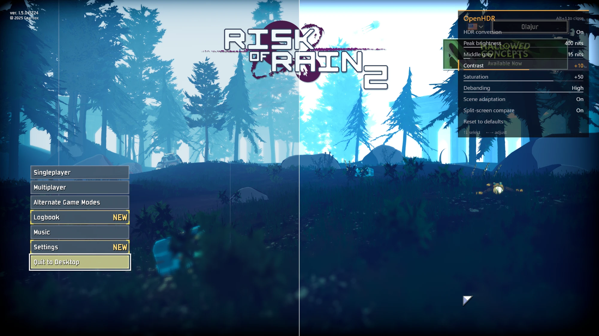
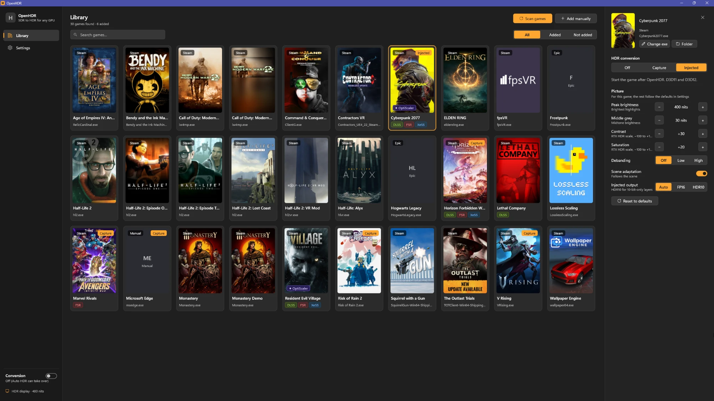
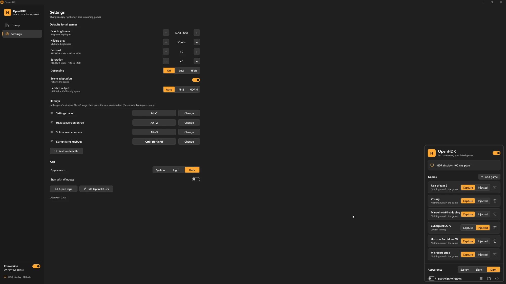

# OpenHDR

SDR→HDR conversion for games on any GPU: AMD, Intel or NVIDIA. Capture mode works with every game
and runs nothing inside it; injected mode converts inside the game for the lowest latency.
Self-contained: no files in game folders, no replaced system DLLs, no ReShade or other third-party
runtime, so it can sit next to mods such as OptiScaler (frame generation included).

**[Download the latest release](https://github.com/Olajur/OpenHDR/releases/latest)** (installer or portable zip).



| Game library | Settings and tray panel |
|---|---|
|  |  |

Each game runs in one of two modes:

| | Capture mode (default) | Injected mode (opt-in) |
|---|---|---|
| How | captures the game window from outside and shows it converted on top | converts the game's swap chain from inside the game |
| Runs code in the game | no | yes |
| Graphics APIs | any (D3D9–12, Vulkan, OpenGL) | Direct3D 11 and 12 |
| Exclusive fullscreen | no (windowed / borderless) | yes |
| Extra latency | about one frame | none measurable |

Turn Windows Auto HDR off for games you use in capture mode, or the image is brightened twice
(Win+G → Settings → Gaming features, or Settings → System → Display → Graphics → the game).

Status: x64, tested on an AMD RX 9060 XT.

## Usage

1. Turn on HDR in Windows (Settings → Display → Use HDR).
2. Run `OpenHDR-Setup.exe`: pick a folder (default `%LOCALAPPDATA%\Programs\OpenHDR`, no administrator
   rights needed) and the options. It installs `OpenHDR.exe`, puts it in the tray, and registers in
   Settings → Apps with an uninstaller. (`OpenHDR-Setup.exe --silent [--dir <folder>]` for scripts.)
3. The main window opens (from the Start menu or desktop shortcut, by double-clicking the tray icon,
   or with the panel's settings button). **Library** lists the games installed with Steam, Epic and
   GOG, with their covers and the upscalers found next to them (OptiScaler, DLSS, FSR, XeSS). Click a
   game, pick **Capture** or **Injected**, and adjust its picture. **Change exe** if OpenHDR picked a
   launcher instead of the game's process (Task Manager → Details shows the right one). **Add
   manually** takes any exe. **Settings** holds the defaults for all games, the hotkeys and app options.
4. The tray icon's panel (single click) has the master switch, your HDR display and your games.
   New games use capture mode.
5. Capture mode starts whenever the game's window is in the foreground, and stops when you switch
   away. Injected mode: start the game *after* OpenHDR.

Logs: `%LOCALAPPDATA%\OpenHDR\logs\` (`<game>.exe.log` for injected mode, `openhdr.exe.log` for the
tray app and capture mode). They can be read while the game runs.

The panel's master switch turns OpenHDR off and on. While off, no new process is touched and capture
stops, so Windows Auto HDR (or nothing) handles new games. Running injected games switch to plain SDR.

In game (both modes):

| Key | Action |
|---|---|
| **Alt+1** | settings panel: HDR on/off, peak brightness, middle grey (midtones), contrast and saturation (−100…+100), debanding, scene adaptation, compare, reset. ↑↓ select, ←→ adjust |
| Alt+2 | toggle HDR conversion |
| Alt+3 | split-screen compare (left plain SDR, right converted) |
| Ctrl+Shift+F11 | dump the frame to `%LOCALAPPDATA%\OpenHDR\dumps` |

The keys can be changed in the main window (Settings → Hotkeys) or in `OpenHDR.ini`'s `[Hotkeys]`
section (`Panel=Alt+1`, `Conversion=`, `Compare=`, `Dump=`; e.g. `Ctrl+Shift+F9`, `Alt+Num1`, `None`).

Settings: `%LOCALAPPDATA%\OpenHDR\OpenHDR.ini` holds the defaults and the game list (tray → Edit
settings). The panel saves per-game overrides to `games\<game>.exe.ini`. Both are re-read live.

## How it works

Injected mode:

```
OpenHDR.exe ── SetWindowsHookEx(WH_CBT) ──▶ Windows loads OpenHDR64.dll into GUI processes
                                             (active only in injected-mode games, inert elsewhere)
game ──renders──▶ SDR proxy texture (game's own format, via the swap chain wrapper's GetBuffer)
                          │  before every Present: one full-screen pass (shaders/itm.hlsl)
                          ▼                         + settings panel blended on top
              real swap chain: R16G16B16A16_FLOAT, flip model, scRGB ──▶ Windows HDR
```

Capture mode:

```
game window (SDR, untouched) ──Windows.Graphics.Capture──▶ OpenHDR.exe
     ──same pass (shaders/itm.hlsl) + panel──▶ FP16 scRGB composition swap chain
     ──▶ topmost, click-through window exactly over the game's client area ──▶ Windows HDR
```

- **Injection** (`src/inject.cpp`, `src/host/main.cpp`): the global CBT hook is installed only while
  OpenHDR is enabled and an injected-mode game is listed. Windows loads the DLL into a process when it
  first creates or activates a window, which for games is before the swap chain exists. In listed
  games the DLL pins itself and patches the DXGI factory vtable; elsewhere it returns at once. The
  tray app hooks with a private copy of the DLL (`%LOCALAPPDATA%\OpenHDR\bin`), so `OpenHDR64.dll`
  can be rebuilt or updated while it runs.
- **Hooks** (`src/hooks.cpp`): `CreateSwapChain` and `CreateSwapChainForHwnd` on the DXGI factory,
  plus the D3D11 view-creation methods (to fill in the proxy's format). Patched once and never
  re-patched; if another hook (e.g. the Steam overlay) loops back into ours, the call goes to the
  module's own function, read from the DLL on disk, so the loop ends.
- **Swap chain wrapper** (`src/swapchain.cpp`): the game gets a wrapper object, the real swap chain's
  vtable is never touched, so overlays hooking it keep working. `GetBuffer`/`GetDesc` show the game
  its original SDR format.
- **Presenters** (`src/presenter.cpp` + `src/dx11_presenter.cpp` / `src/dx12_presenter.cpp`): the shared
  base handles settings, hotkeys and the panel. D3D11 converts in its own `ID3DDeviceContextState`;
  D3D12 keeps one proxy per buffer and runs its own command list on the game's queue right before
  Present, with its own allocators and fence. Both fix up views of the typeless proxies through hooks
  on the device's view-creation methods.
- **Main window and library** (`src/host/main_window.cpp`, `src/host/library.cpp`): the library reads
  Steam's library folders, manifests and cover cache, Epic's launcher manifests and GOG's registry
  entries (local files only, no network), and picks each game's exe (Unreal's `-Shipping.exe`, else the
  best name match, skipping launchers, crash handlers, redistributables and engine tools).
- **Tray panel and installer** (`src/host/flyout.cpp`, `src/setup/setup.cpp`, `src/ui/ui.cpp`): a small
  Direct2D/DirectWrite UI kit in the Windows 11 style, following the light/dark app mode. The installer
  embeds the built app as resources and installs per user.
- **Capture session** (`src/capture/capture.cpp`): runs on its own thread in the tray app. The window
  overlay is `WS_EX_TRANSPARENT | WS_EX_LAYERED | WS_EX_NOACTIVATE`, so input goes to the game.
- **Shared** (`src/config.cpp`, `src/itm_params.cpp`, `src/osd.cpp`, …): settings, shader
  parameters and the settings panel, used by both modes.
- **Conversion** (`shaders/itm.hlsl`): debanding → TPDF dither → decode with the contrast gamma
  (contrast 0 / +25 / +50 = gamma 2.0 / 2.2 / 2.4) → saturation → highlight expansion above `ShoulderStart`, up to the display peak
  (`IDXGIOutput6::GetDesc1`).
- **Scene adaptation** (`src/scene.cpp`, `shaders/scene.hlsl`): every frame a small pass reduces the
  image to a 64×36 grid (mean luminance, bright and near-white share, maximum), read back a few frames
  late without stalling. Smoothed over time (0.25 s towards brighter, 1 s towards darker), it lowers
  the highlight headroom for large bright areas (and respects the display's full-frame limit), lowers
  the expansion shoulder in dark scenes and raises it in bright ones. `SceneDebug=1` logs it per frame.

## Build

Requires Visual Studio 2022 (C++), CMake ≥ 3.20 and the Windows 10/11 SDK (with C++/WinRT headers).

```bash
cmake -S . -B build -G "Visual Studio 17 2022" -A x64
```
```bash
cmake --build build --config Release
```

Output in `build/bin/Release/`: `OpenHDR-Setup.exe` (the installer, with everything inside),
`OpenHDR.exe`, `OpenHDR64.dll`, `OpenHDR.ini`, and the test apps `sdr_test.exe` (D3D11) and
`sdr_test12.exe` (D3D12). `OpenHDR.exe --snapshot-flyout x.png` and `OpenHDR-Setup.exe --snapshot <dir>`
render the UI to PNG files for design checks (`OPENHDR_THEME=light|dark` to pick the theme), as does
`OpenHDR.exe --snapshot-main x.png [page 0|1] [game index]` for the main window.
`OpenHDR.exe --scan-library out.txt` lists what the library finds. `OpenHDR.exe --tray` starts in the
tray only (what autostart uses).

## Testing without a game

```bash
build/bin/Release/OpenHDR.exe --add-game sdr_test.exe
```
```bash
build/bin/Release/OpenHDR.exe --add-game-injected sdr_test.exe
```

(The first adds it in capture mode, the second in injected mode.)

Start `OpenHDR.exe`, then run `sdr_test.exe`. Scenarios: `--flip`, `--resize-test`, `--unity`
(Unity's exclusive-fullscreen recreation), `--vrising` (second blt chain next to a live flip chain),
`--srgb-rtv` (Unity linear colour space), `--hostile-hooks` (an overlay that re-hooks like Steam's),
`--gpu-load N` (N draws per frame, to saturate the GPU), `--frames N`. `sdr_test12.exe` is the D3D12 equivalent (`--srgb-rtv`, `--null-rtv` for format-less
render target views, `--resize-test`, `--frames N`). With `DumpFrame=60` in the ini, `python tools/analyze_dump.py --peak <nits>` checks the
dumped grey ramp against the expected curve, and `python tools/pfm.py output.pfm preview.png <nits>`
makes a viewable preview. `OPENHDR_OSD_OPEN=1` starts with the panel open; for the tray app,
`OPENHDR_CAPTURE_ANY_WINDOW=1` captures a listed window even when it is not in the foreground
(test processes can't take the foreground).

## Known limitations

- Injected mode: only games started after OpenHDR are converted. While an injected-mode game is
  listed, Windows loads the inert DLL into every GUI process; games with integrity protection should
  use capture mode instead.
- Capture mode: windowed/borderless only, about one frame of extra latency, and a game window that
  opts out of capture shows black. The overlay is shown only while the game is in the foreground.
  The conversion is a small GPU pass that has to finish before the next screen refresh; when the game
  keeps the GPU 100% busy it waits behind the game's queued frames, and frames show one or two
  refreshes late (lag, uneven pacing). Variable refresh rate (FreeSync/G-Sync) does not apply to the
  converted image, so every game frame stays on screen for a whole number of refreshes: 60 fps on a
  144 Hz display alternates 2 and 3 refreshes (judder), 80 fps alternates 1 and 2. For smooth motion,
  cap the game at the refresh rate divided by a whole number that the GPU sustains with some headroom
  (144 Hz: 72 or 48 fps; 120 Hz: 60 fps), with in-game VSync off (in-game limiter or Radeon FRTC).
  The log (`openhdr.exe.log`) shows this every 5 seconds ("on screen for 1/2/3+ refreshes").
- Capture mode can confuse performance overlays that follow the presenting fullscreen app (the
  converted image is a second one); use the log or an external tool such as PresentMon instead.
- Injected mode with frame generation mods (OptiScaler's XeFG): the frame generation hands the game a
  swap chain of its own and presents to one it creates inside the game's call. With `libxess_fg.dll`
  loaded, OpenHDR converts that inner swap chain instead, so generated frames are converted too
  (tested with a stand-in layer, `sdr_test12 --fake-fg`; not yet confirmed in a real game).
  `OutputFormat=hdr10` makes injected mode output 10-bit HDR10 instead of FP16, for layers that only
  accept 8/10-bit swap chains.
- Elevated (admin) games need `OpenHDR.exe` to run elevated too. 32-bit games need a 32-bit build
  (injected mode). Store/UWP games are not supported yet.
- Arrow keys also reach the game while the panel is open.
- The proxy back buffer is typeless (so `_SRGB` views work, as Unity's linear colour space needs),
  so its `GetDesc` reports e.g. `R8G8B8A8_TYPELESS` instead of `R8G8B8A8_UNORM`.
- Unity's exclusive fullscreen uses a second, blt-model swap chain next to its flip-model one.
  It is converted in blt model (a window can have only one flip-model chain).
- No UI/HUD detection: the curve applies to the whole image, HUD included.

## Roadmap

1. Borderless helper for capture mode (switch exclusive-fullscreen-only games to borderless from outside).
2. Automatic Windows Auto HDR detection per game.
3. HUD-aware conversion (keep UI elements at paper white); 32-bit build.
